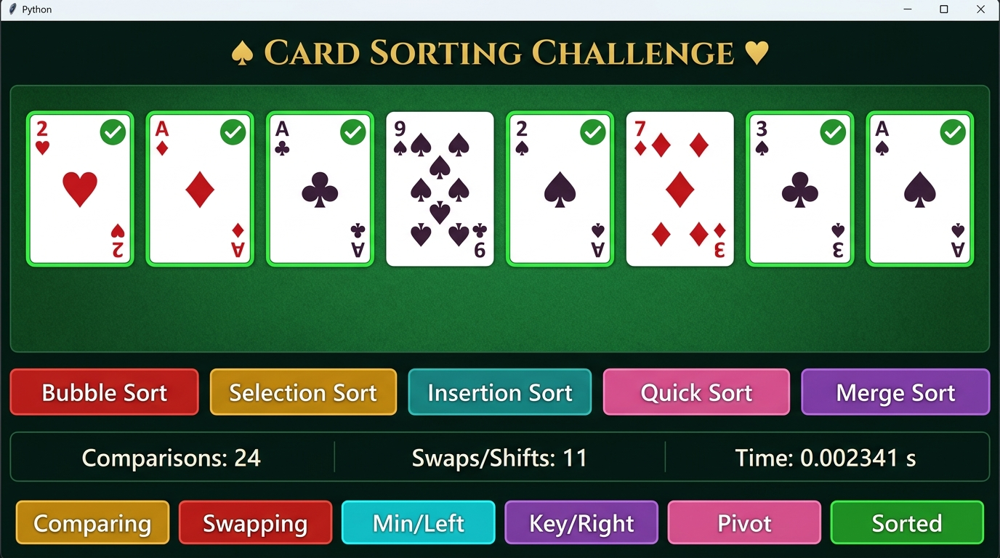

# ♠ Card Sorting Challenge ♥

> **An interactive DSA learning game** — drag cards to sort them manually, or watch 5 classic sorting algorithms come to life with smooth step-by-step animations.



---

## 🎮 What Is This?

**Card Sorting Challenge** is a Python desktop game built with **Tkinter** that teaches Data Structures & Algorithms (DSA) through a playing-card theme. You can:

- **Play manually** — drag and drop cards to sort them by rank, then check your answer for points.
- **Watch algorithms** — trigger any of 5 sorting algorithms and see every comparison, swap, and merge animated live on the card canvas.
- **Compare performance** — run all 5 algorithms on the same dataset and compare their comparisons, movements, and real elapsed time side-by-side.

---

## ✨ Features

| Feature | Details |
|---|---|
| 🃏 **Full 52-card deck** | Ace through King across all 4 suits (♥ ♦ ♣ ♠) |
| 🖱️ **Drag & Drop** | Manually reorder cards by dragging; cards snap back if dropped in open space |
| 🔀 **Riffle Shuffle** | Animated 2-pass riffle shuffle when reshuffling |
| 🎲 **New Deal** | Draw 8 fresh random cards with a fan-deal animation |
| 🏆 **Score System** | +100 points for each correctly ordered hand |
| 📊 **Live Statistics** | Real-time comparison count, swap/shift count, and elapsed time |
| ⚡ **Adjustable Speed** | Slider from 0.5× to 3.0× animation speed |
| 📋 **Algorithm Comparison** | Side-by-side table of all 5 algorithms on the same 12-card test |
| 🎉 **Celebration Wave** | Sequential card-hop animation on sort completion |

---

## 🧠 Sorting Algorithms Visualized

Each algorithm is implemented as a **Python generator** that yields step-by-step state snapshots. This lets the GUI animate every single comparison and movement independently.

### 1. 🔴 Bubble Sort
- Repeatedly compares adjacent cards and swaps if out of order
- Each pass bubbles the largest unsorted card to the end
- **Complexity:** O(n²) average/worst · O(n) best (early-exit optimized)
- **Visual:** Gold highlight on compared pair → Red on swap

### 2. 🟡 Selection Sort
- Scans the unsorted region to find the minimum card
- Places it at the front of the unsorted region
- **Complexity:** O(n²) all cases
- **Visual:** Cyan highlight on current minimum → Red on final swap

### 3. 🟢 Insertion Sort
- Lifts a "key" card and shifts larger cards right to find its place
- Efficient on nearly-sorted data
- **Complexity:** O(n²) average/worst · O(n) best
- **Visual:** Purple highlight on key → Red on each rightward shift

### 4. 🩷 Quick Sort
- Picks a pivot (rightmost card) and partitions the subarray around it
- Recursively sorts left and right partitions
- **Complexity:** O(n log n) average · O(n²) worst
- **Visual:** Pink highlight on pivot → Cyan on left boundary → Red on swap

### 5. 🟣 Merge Sort
- Recursively splits into halves, then merges sorted halves back together
- Uses a **2-lane buffer** animation: cards lift up, get compared, then drop in sorted order
- **Complexity:** O(n log n) all cases
- **Visual:** Cyan = LEFT half · Purple = RIGHT half · Green = MERGED

---

## 🎨 Color Legend

| Color | Meaning |
|---|---|
| 🟡 Gold | Comparing / Scanning |
| 🔴 Red | Swapping / Shifting |
| 🩵 Cyan | Minimum / Left Half |
| 🟣 Purple | Key Card / Right Half |
| 🩷 Pink | Quick Sort Pivot |
| 🟢 Bright Green | Sorted / Merged |

---

## 🚀 Getting Started

### Prerequisites

- **Python 3.8+**
- **Tkinter** (bundled with standard Python on Windows & macOS)

Verify Tkinter is available:
```bash
python -m tkinter
```

### Run the Game

```bash
git clone https://github.com/M-D-AFTAB/Python-Card-Sorting-Game.git
cd Python-Card-Sorting-Game
python card_sorting_game.py
```

No pip installs needed. Pure standard-library Python.

---

## 🕹️ How to Play

### Manual Mode
1. Launch the game — 8 random cards are dealt automatically.
2. **Drag cards** to rearrange them in ascending order (Ace = 1, lowest).
3. Click **🏆 Check Order** to verify — earn 100 points if correct!
4. Click **🎲 New Cards** to deal a fresh hand, or **🔀 Shuffle** to scramble the current hand.

### Visualizer Mode
1. Click any algorithm button (**Bubble Sort**, **Selection Sort**, etc.).
2. Watch the cards animate through every step of the algorithm.
3. After completion, a summary popup shows comparisons, movements, and time.
4. Adjust the **⚡ Speed** slider to slow down or speed up the animation.

### Compare Mode
1. Click **📊 Compare All 5 Algorithms**.
2. A popup table shows all 5 algorithms run on the same 12-card input.
3. Compare efficiency directly — divide-and-conquer algorithms shine!

---

## 📁 Project Structure

```
Python-Card-Sorting-Game/
├── card_sorting_game.py   # Main application (~1866 lines, single file)
├── screenshot.jpg         # Game UI preview
└── README.md              # This file
```

### Code Map

| Lines | Section |
|---|---|
| 1–71 | Constants, color palette, deck & card helpers |
| 77–128 | `bubble_sort()` step generator |
| 131–211 | `selection_sort()` step generator |
| 214–284 | `insertion_sort()` step generator |
| 287–396 | `quick_sort()` step generator |
| 399–555 | `merge_sort()` step generator |
| 562–836 | UI construction (`build_ui`) |
| 849–1031 | Layout, drawing & animation helpers |
| 1037–1149 | Shuffle, deal & celebration animations |
| 1155–1283 | Game logic & drag-and-drop |
| 1289–1731 | Sorting visualizer engine |
| 1744–1856 | Algorithm comparison popup |

---

## 🏗️ Architecture Overview

```
CardSortingGame (Tkinter root)
│
├── Deck & Card Utilities
│   ├── create_deck()       → 52 (value, suit) tuples
│   ├── card_text()         → "A♥"
│   └── card_color()        → Red for ♥/♦, Dark for ♣/♠
│
├── Sorting Generators  (yield step dicts with cards + metadata)
│   ├── bubble_sort(cards)
│   ├── selection_sort(cards)
│   ├── insertion_sort(cards)
│   ├── quick_sort(cards)
│   └── merge_sort(cards)
│
├── Animation Engine
│   ├── animate_trajectories()    → Smooth eased arc motion for N cards
│   ├── animate_shuffle_and_deal()
│   └── celebrate_wave()
│
└── Visualizer Engine
    ├── start_sort(name)          → Seeds generator, starts timer
    └── animate_sort_step()       → Consumes one step → dispatches animation
```

---

## 🎓 Educational Value

- Every algorithm is a **self-contained generator** — readable independently of the GUI.
- Real **comparison and movement counts** make complexity analysis tangible.
- The **comparison table** lets you empirically observe O(n²) vs O(n log n) behavior.
- **Step-by-step animation** makes abstract pseudocode concrete and memorable.

---

## 🛠️ Tech Stack

| Technology | Role |
|---|---|
| Python 3 | Core language |
| Tkinter | GUI framework (canvas, widgets, event loop) |
| `random` | Deck shuffling & random card selection |
| `time` | High-precision algorithm timing (`perf_counter`) |
| `math` | Arc/sine curves for smooth card trajectories |

---

## 🤝 Contributing

Pull requests are welcome! Ideas:

- Add more algorithms (Heap Sort, Shell Sort, Radix Sort)
- Add step-back / pause / resume controls
- Sound effects for swaps and comparisons
- Persistent high-score leaderboard
- Support for different hand sizes (4, 6, 10, 13 cards)

---

## 📄 License

Open source. Free to use, share, and adapt for learning.

---

<div align="center">

Made with ♥ in Python · Built to make DSA visual and fun

</div>
